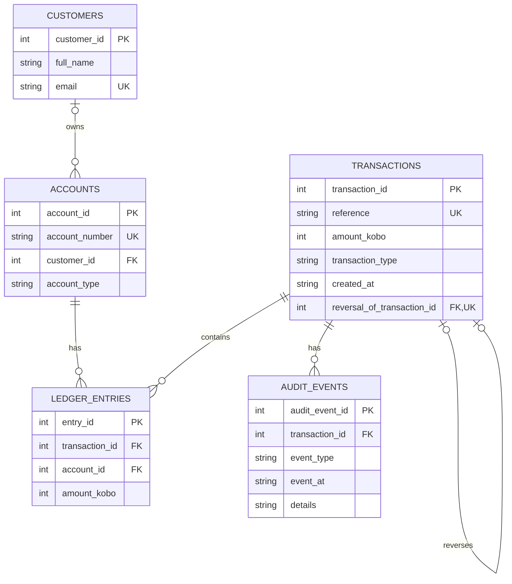

# Portfolio 1: Database design and modelling

## ER Diagram


## Case study and design

I have two customers, Ada who has account `10001` and Tunde who has the account number `10002`. Then `90001` is the bank clearing account. I stored the money as whole kobo (100 kobo = ₦1) so that any calculations ran will use exact integers instead of using rounded decimal values.

The model has five types of data:

- `customers` shows that a customer record exists, only one per customer.
- `accounts` stores the accounts that each customer owns.
- `transactions` stores an event and the event's unique reference, type, amount, and date.
- `ledger_entries` stores the signed effect of that event on each account. A negative amount means that money has left; a positive amount means it has been credited into the account.
- `audit_events` stores a record that a transaction was either posted or reversed.

A customer can own multiple accounts, also each customer account must have an owner. Unlike customer accounts the clearing account has no ownder. Tranasactions are linked to their respective ledger entries, and a reversal is a new transaction that is linked to the original. This ensures the original event is available for review.

## Tables and keys

| Table | What it stores | Primary key | Foreign key |
| --- | --- | --- | --- |
| customers | Customer details | customer_id | None |
| accounts | Customer and clearing accounts | account_id | customer_id |
| transactions | Deposit, withdrawal, transfer or reversal | transaction_id | reversal_of_transaction_id |
| ledger_entries | The effect on one account | entry_id | transaction_id, account_id |
| audit_events | Basic posting events | audit_event_id | transaction_id |

## Keys, constraints, and normalisation

Each table has a primary key, while foreign keys either connect accounts to customers, ledger entries to accounts and transactions or audit events to transactions. The unique constraints prevent things like duplicate emails, duplicate account numbers, etc. Then the check constraints put restrictions on transaction and account types. They also require positive transaction amounts and don't allow zero ledger entries. Then they enforce the customer-versus-clearing account ownership rule.

I separated customer, account, transaction, and ledger facts so the same details do not need to be copied into every row. This supports normalisation because each field needs to hold one value (1NF). The tables use single-column primary keys which avoids partial-key dependencies (2NF). Then each fact is stored with the entity that it describes (3NF). Balances are being calculated fro the ledger history,

## Implementation and evidence

I defined the tables in `Lewu_Oyindamola_P1Schema.sql` and added deposit, transfer, withdrawal, and reversal operations in `Lewu_Oyindamola_P1SampleData.sql`. I used `Lewu_Oyindamola_P1Checks.sql` to load them into an in-memory SQLite database, after which it inspected the tables and transactions, calculated balances, and totaled the entries for each transaction. The console output is saved in `Lewu_Oyindamola_P1Results.txt`.

To repeat the checks from the repository root:

```sh
sqlite3 :memory: < portfolio-1-database-design/Lewu_Oyindamola_P1Checks.sql
```

The sample output shows Ada at 75,000 kobo (₦750), Tunde at 25,000 kobo (₦250), and the clearing account at -100,000 kobo (-₦1,000). Each sample transaction has two entries whose total is zero. The final four error messages deliberately try a duplicate reference, a zero transaction amount, a customer account without an owner, and a ledger entry for a nonexistent account. SQLite rejects each invalid insert attempt.
