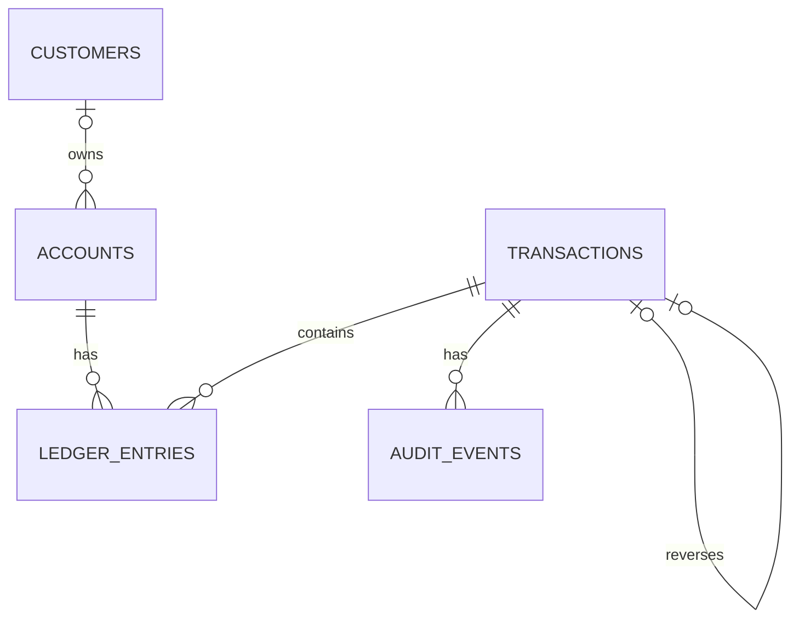
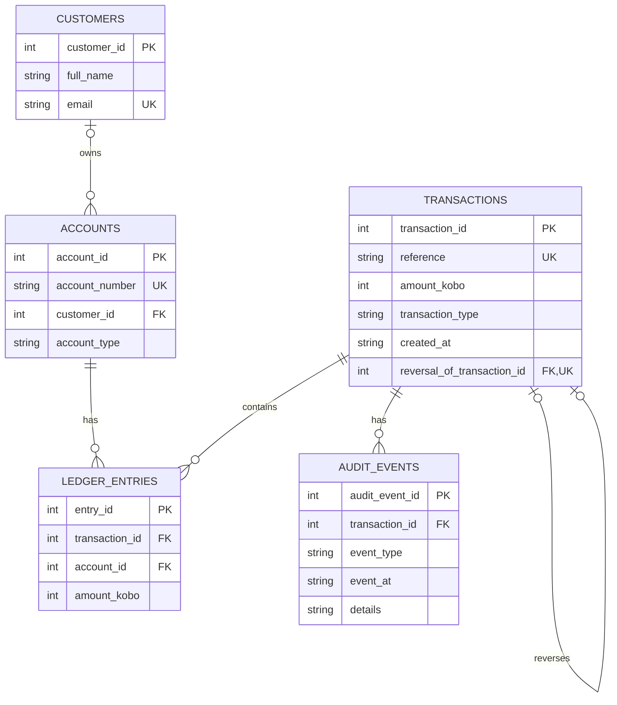

# Portfolio 1: Database design and modelling

## ER Diagram

## Tables and keys

| Table | What it stores | Primary key | Foreign key |
| --- | --- | --- | --- |
| customers | Customer details | customer_id | None |
| accounts | Customer and clearing accounts | account_id | customer_id |
| transactions | Deposit, withdrawal, transfer or reversal | transaction_id | reversal_of_transaction_id |
| ledger_entries | The effect on one account | entry_id | transaction_id, account_id |
| audit_events | Basic posting events | audit_event_id | transaction_id |

## How I tested the design

I loaded `schema.sql` and `sample_data.sql` into a temporary SQLite
database, then ran the commands in `checks.sql`. The output is saved in
`results.txt`. Foreign-key checking was enabled as well.

The sample has a deposit, a transfer, a withdrawal and a reversal. The
reversal is linked to the withdrawal, but the original withdrawal is
still present. After all four transactions, Ada's balance is ₦750 and
Tunde's balance is ₦250.

I checked the ledger entries for every sample transaction. Each
transaction has two entries, and each pair adds to zero. I also tried
reusing a transaction reference, entering a zero transaction amount,
creating a customer account without an owner, and using an account ID
that does not exist. SQLite rejected all four invalid inserts.

These checks show that my sample data balances and that the listed
constraints work. The schema does not, by itself, force every future
transaction to have exactly two balanced entries or prevent an
overdraft. I will address transaction posting and balance checks in
Portfolio 3.

## Normalisation

**First normal form (1NF):** I stored one value in each field. A
customer's accounts and a transaction's ledger entries are separate
rows, rather than lists inside one field.

**Second normal form (2NF):** Each table has a single-column primary
key, so a non-key field cannot depend on only part of a composite
primary key.

**Third normal form (3NF):** I kept customer details in `customers` and
account details in `accounts`. A ledger entry stores account and
transaction IDs rather than copying customer names or transaction
details. I calculated balances from ledger entries instead of storing
another balance value that could disagree with them.